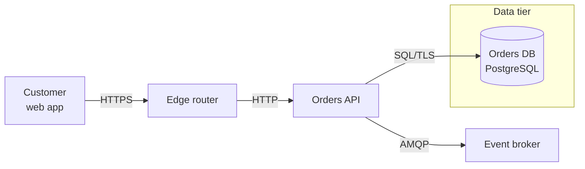
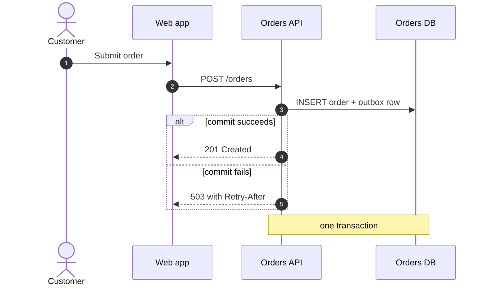
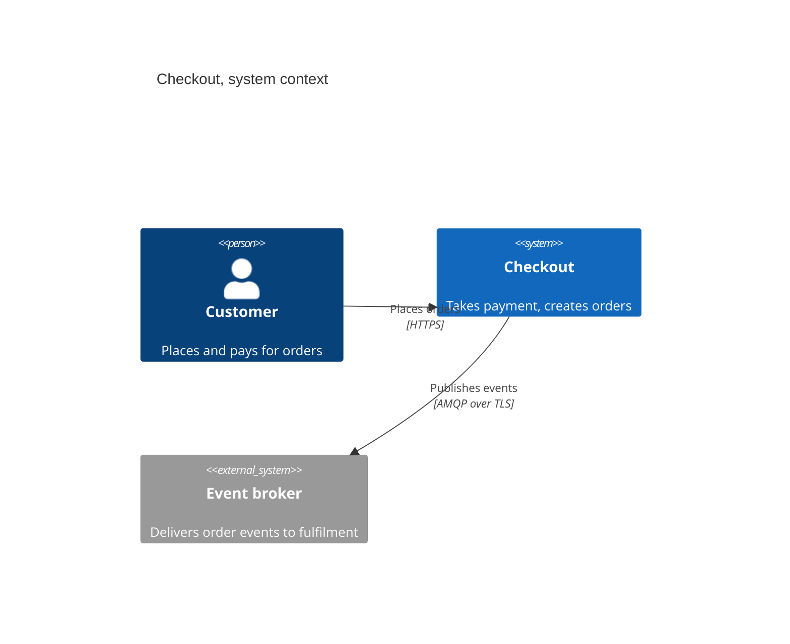
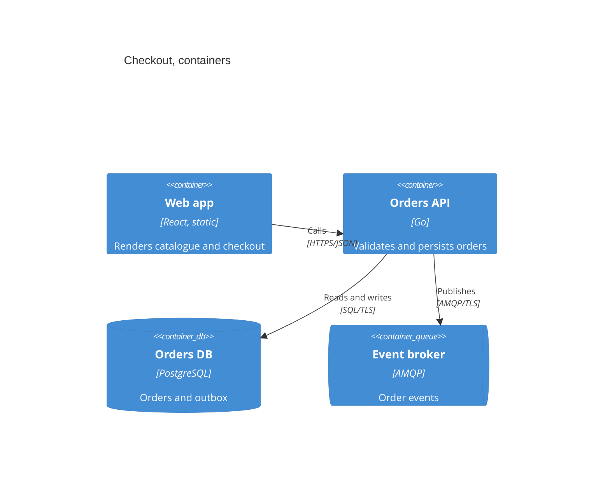
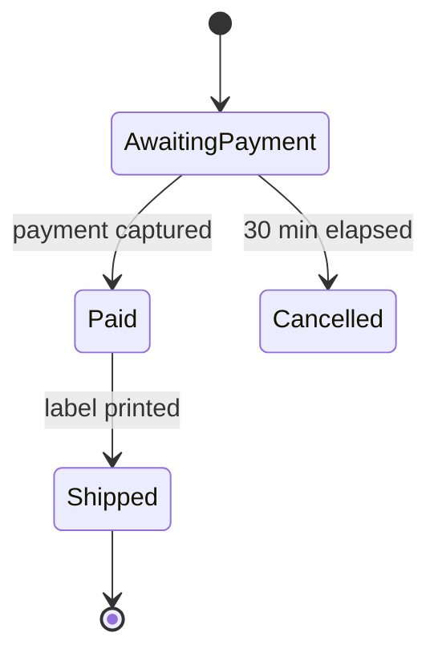
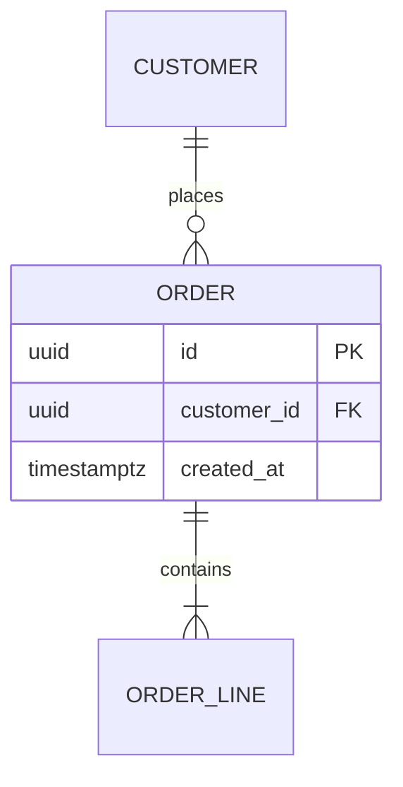

**Load this reference when:** writing or debugging Mermaid for an architecture document.

# Mermaid for Architecture

Mermaid is a text format that renders to SVG. Its value is that a diagram lives in review, diffs like code, and breaks a build when it stops parsing. Its cost is a parser that is stricter and quirkier than it looks, so the traps below account for most failures seen in practice.

## Choosing the diagram type

| Question | Type | Declared as |
|---|---|---|
| Who calls whom, with boundaries | flowchart | `flowchart LR` |
| What runs where, with nested environments | flowchart with subgraphs | `flowchart TB` |
| Call order, retries, alternatives | sequence | `sequenceDiagram` |
| System in its environment, C4 style | C4 context | `C4Context` |
| Deployable units, C4 style | C4 container | `C4Container` |
| Record lifecycle, order states | state | `stateDiagram-v2` |
| Entities and cardinalities | entity relationship | `erDiagram` |

Prefer `flowchart` over `graph`: the two share syntax, but `flowchart` is the name the current renderer documents and the one that gains new node shapes. Prefer a sequence diagram for anything with retries, because the retry loop is the point and a flowchart cannot show it without lying about order.

## Flowchart



- Node ids are short and stable; labels carry the meaning. `orders["Orders API"]`.
- Arrows carry a label wherever the protocol, payload or trigger matters: `-->|SQL/TLS|`.
- Shapes: `["text"]` rectangle, `("text")` rounded, `([text])` stadium, `[(text)]` cylinder for a store, `{"text"}` rhombus, `{{"text"}}` hexagon, `[["text"]]` subroutine, `(("text"))` circle.
- `subgraph id["Title"]` groups; keep elements declared inside the block, and reference them by id elsewhere.
- Layout hints (`LR`, `TB`, `RL`, `BT`) are hints. If the layout is unacceptable, split the diagram; do not add invisible nodes.

## Sequence



- `->>` is a request, `-->>` a reply, `-x` a failure. Use the distinction; a diagram where every arrow is `->>` hides which messages are fire-and-forget.
- `alt` / `else` / `opt` / `loop` / `par` each close with `end`. An unclosed block is a parse error, and the message points at the next line rather than the missing one.
- `autonumber` gives every message a number, which is what lets a prose section refer to "step 4".
- Declare participants explicitly when order matters. Implicit participants appear in first-use order, which changes when someone edits an earlier line.

## C4





- The first line selects the diagram: `C4Context`, `C4Container`, `C4Component`, `C4Dynamic`, `C4Deployment`.
- Elements take positional arguments, so every label is comma-separated and every label containing a comma **must** be quoted.
- Available elements include `Person`, `Person_Ext`, `System`, `System_Ext`, `SystemDb`, `Container`, `ContainerDb`, `ContainerQueue`, `Component`, plus `Boundary`, `Enterprise_Boundary`, `System_Boundary`, `Container_Boundary` and `Deployment_Node`.
- `Rel(from, to, label, tech)` — both labels optional after the third argument, but write both; the protocol is the useful part.
- C4 support is experimental and layout is automatic. If the result is unreadable, prefer a `flowchart` with the same content over fighting the layout with `UpdateRelStyle` coordinates.

## State and ER





- State: `[*]` is start and end; a transition label follows the only colon allowed on that line. Long state names get an alias: `state "Awaiting payment" as AwaitingPayment`.
- State descriptions use `AwaitingPayment : retries the authorisation every 5 s`, which is a second colon form but a different statement — do not mix it with a transition on the same line.
- ER: attributes are `type name`, then optional `PK`, `FK`, `UK` and a quoted comment. Type first is mandatory.
- ER cardinality is two tokens around the line: `||--o{` is exactly one to zero-or-more. Write the cardinality you will enforce, not the one that looks tidy.

## Syntax traps

| Symptom | Cause | Fix |
|---|---|---|
| Parse error on a label | unquoted `(`, `)` or brackets; a parenthesised label is read as a node shape | quote the whole label: `A["GET /users (cached)"]` |
| Parse error in a C4 block | unquoted comma; commas separate positional arguments | quote every C4 label |
| A node named `end` breaks the diagram | `end` closes `subgraph` and blocks | rename to `end_node` |
| Edge text is a parse error | `A --> B : text` is not edge-label syntax | `A -->\|text\| B` or `A -- text --> B` |
| Two boxes merge | the same id declared twice; the last label wins silently | one declaration per id; labels change, ids do not |
| Sequence block swallows later messages | missing `end` for `alt` / `loop` / `par` | close every block; check nesting |
| ER relationship rejected | one cardinality token instead of two | `A \|\|--o{ B : label` |
| ER attribute silently swapped | the first token is the type, so `name string` becomes a field called `string` | `string email` — type first |
| Styles apply to nothing | `style` or `classDef` on a renamed or misspelt id; nothing is raised | grep the ids after any rename |
| Line breaks differ between renderers | `\n` works in some versions and element types, and not in others | `<br/>` inside a quoted label |
| Subgraph cannot be referenced by name | the title became the id, and it contains a space | `subgraph edge["Edge services"]` |
| Renders locally, fails in CI | renderer version difference | pin the renderer version in the command and in CI |

## Pre-flight self-check

Run this before delivering any diagram:

- [ ] The first line declares the diagram type, and no content precedes it.
- [ ] Every label containing `(`, `)`, `/`, `:`, `,`, `[`, `]`, `{`, `}` or `&` is quoted.
- [ ] Line breaks use `<br/>`; no `\n` remains inside a label.
- [ ] No node id is `end`, `graph`, `subgraph`, `class`, `style` or `linkStyle`.
- [ ] Every `subgraph` has a single-token id and a quoted title.
- [ ] Every `alt`, `opt`, `loop` and `par` block is closed with `end`.
- [ ] Every arrow crossing a container or system boundary has a label.
- [ ] No node is orphaned; every node participates in at least one relationship, and nodes declared only for layout are removed.
- [ ] The diagram is under roughly twenty visible elements; if not, it was split by scope.
- [ ] The rendered SVG was opened and read — a character silently dropped still renders "successfully".

## Rendering

```console
npx -y @mermaid-js/mermaid-cli@11 -i docs/diagrams/container-checkout.mmd -o /tmp/container-checkout.svg
echo $?   # 0 means the source parsed and rendered
```

- Pin the major version. Syntax support changes between releases, and an unpinned `npx` makes a previously green document fail for reasons unrelated to the document.
- Headless Chromium is a dependency. In a container without sandbox support, pass a puppeteer config containing `{"args": ["--no-sandbox"]}` via `-p`.
- If the repository's docs build renders diagrams, render every `.mmd` there, not just the ones that changed recently; an untouched diagram is the one that breaks during a release. A repository with no diagram job verifies locally instead of adding a headless-Chromium dependency.
- To verify a fenced block inside a Markdown document, extract it first:

```console
python3 - <<'PY'
import pathlib, re
text = pathlib.Path("docs/design.md").read_text(encoding="utf-8")
for n, block in enumerate(re.findall(r"```mermaid\n(.*?)```", text, re.S), 1):
    pathlib.Path(f"/tmp/fenced-{n}.mmd").write_text(block, encoding="utf-8")
    print(f"/tmp/fenced-{n}.mmd")
PY
```

Then render each extracted file with the same command. A fenced block that has never been extracted and rendered is an untested claim.

- Commit the `.mmd` source, not only the SVG. The source is reviewable; the SVG is build output. When both are committed, the source is authoritative and the SVG is regenerated on every change.
