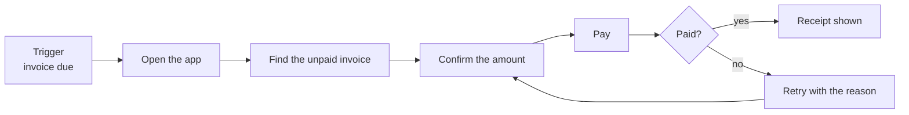

**Load this reference when:** running UX mode — framing the job a screen serves, drawing the journey, or deciding what each screen does in its empty, loading, error, partial and no-permission states.

## Contents

- [Jobs to be done](#jobs-to-be-done)
- [The journey](#the-journey)
- [The five-state matrix](#the-five-state-matrix)
- [Edge roles](#edge-roles)
- [UX exit test](#ux-exit-test)

## Jobs to be done

A job is a change of state the user wants, not a feature. "Manage invoices" is a feature
list; "get paid before the end of the month without chasing anyone" is a job. Write the job
in the user's words and the screen's job becomes checkable.

Ask these, in this order, and write the answer to each down. An unanswered question is a
recorded assumption, not a silent default.

| Question | What a usable answer looks like | What it rules out |
|---|---|---|
| When does the job start? | A trigger in the user's world — an email, a deadline, a failed payment | A screen nobody is pulled toward |
| Who is the user at that moment? | Role, context, device, time pressure, and what they already know | A persona page with no bearing on the build |
| What do they do today instead? | The incumbent: a spreadsheet, a phone call, a competitor | Solving a problem nobody has |
| What is the cost of getting it wrong? | A concrete consequence — money, a support ticket, a legal exposure | Undo being optional |
| What tells them it worked? | A state they can see — the receipt, the check, the number | "Feels good" as an acceptance criterion |
| What is out of scope? | One sentence naming the adjacent job this screen will not do | Scope creep discovered at review |

**Success signal.** Name the event that proves the job completed, and say where it is
observable. If the only signal is a feeling, the design cannot be evaluated and the UX rubric
will have nothing to score.

## The journey

Draw the journey before drawing any screen. One diagram, the happy path, numbered steps.
Every step becomes a screen or a state, and every step that needs a screen gets a wireframe.

Rules that keep the diagram honest:

- One arrow, one user action. Decision diamonds carry the question, not the outcome.
- Number the steps when the diagram has more than six nodes; the numbers are what the
  wireframe specs and the task scripts refer to.
- Mark the step where the user is most likely to abandon. That step is the one that gets the
  most design attention, not the one that is most fun to draw.
- A loop back to an earlier step is a real finding: either the user can recover in place, or
  the step before it is wrong.

## The five-state matrix

Every screen answers five questions. The matrix is the answer sheet; a screen with a blank
cell is an unbuilt screen.

| State | The question it answers | What counts as designed |
|---|---|---|
| **Empty** | Nothing exists yet — first run, or a filter matched nothing | Says what would be here, and how to create the first item. Distinguish *no data yet* from *no results for this filter* — they need different copy and different actions |
| **Loading** | The request is in flight | A stable skeleton that matches the final layout, or an explicit progress indicator after ~300 ms. A spinner that replaces the layout makes the page jump |
| **Error** | The request failed | What failed, whether the user's data is safe, and the next action. Distinguish *retryable* (network, timeout) from *not retryable* (validation, permission) — a retry button on a permanent error is a trap |
| **Partial** | Some data arrived | Which parts are stale, missing or degraded, and whether the user can act on what did arrive. Never render a partial response as if it were complete |
| **No permission** | The user exists but may not do this | Who can grant access and how to ask. Not a 403 screen with no path forward |

Write the matrix as a table per screen:

| Screen | Empty | Loading | Error | Partial | No permission |
|---|---|---|---|---|---|
| `{{Invoice list}}` | {{"No invoices yet — create the first one" + primary action}} | {{row skeleton, 5 rows}} | {{"Could not load invoices" + retry; data last loaded at …}} | {{stale banner with timestamp; rows still actionable}} | {{"Ask your finance admin for access" + link}} |

A cell that reads *not applicable* needs the reason next to it — "not applicable: the list is
populated by the server on first request" is a decision; a bare dash is an omission.

**Order of implementation** when time is short: error and empty before the happy path's
polish. A beautiful populated state with no empty state ships a screen that breaks on the
first real use.

## Edge roles

The five states are about data. These roles are about who is looking; they change what the
same screen must offer.

| Role | What changes |
|---|---|
| **New user** | No data, no history, no trusted defaults. The screen must teach the first action in place — a tour that overlays the UI is a weaker answer than an empty state that does the job |
| **Returning user** | Has data and expectations. The screen must get out of the way: preserve last position, filters and sort; do not re-explain the UI |
| **Power user** | Works at speed, keyboard-first. The path must be operable without the mouse, with no modal in the middle of a repeat action |
| **No permission** | Sees the screen, cannot act. Hide the action or show it disabled *with the reason and the route to access* — a disabled control with no explanation is indistinguishable from a bug |
| **Offline / flaky** | The write may not land. Distinguish queued from saved; never claim success before the server confirmed it |

Name which roles the screen is designed for. A screen designed for all five is designed for
none — state the two that matter and what the others get.

## UX exit test

Before leaving step 2 of the workflow, these must all be true:

- [ ] The job is written in the user's words, with a trigger and a success signal.
- [ ] The journey is drawn, numbered, and names the abandonment point.
- [ ] Every screen in the journey has a full five-state row, with reasons for any
      *not applicable*.
- [ ] The roles the screen serves are named, and each one's difference is reflected in at
      least one state or action.
- [ ] Every assumption made because a question went unanswered is recorded as an assumption,
      not presented as a requirement.
