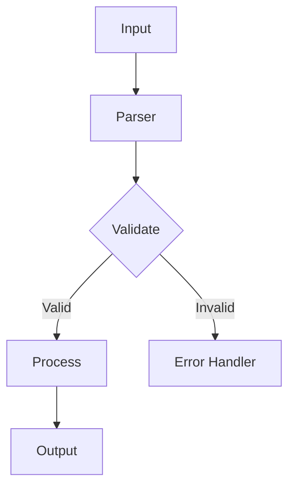
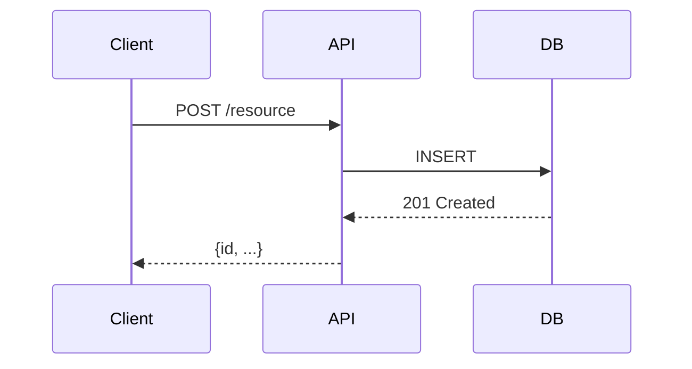
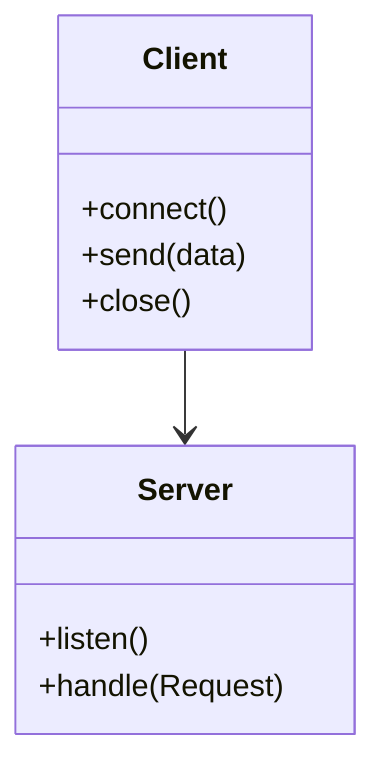

# Wiki Page Templates

**Load this reference when:** writing or filling the content of a wiki page.

One template per page id. Each gives the page's purpose, the minimum content threshold, the files to read, and the sections the page must contain.

## Contents

- [Conventions](#conventions)
- [1. Overview](#1-overview)
- [1.1 Quick Start](#11-quick-start)
- [2. Project Structure](#2-project-structure)
- [2.1 CLI Commands](#21-cli-commands)
- [2.2 API Reference](#22-api-reference)
- [3. Configuration](#3-configuration)
- [3.1 Installation](#31-installation)
- [3.2 Deployment](#32-deployment)
- [4. Usage](#4-usage)
- [4.1 Troubleshooting](#41-troubleshooting)
- [4.2 FAQ](#42-faq)
- [5. Development](#5-development)
- [5.1 Testing](#51-testing)
- [5.2 Contributing](#52-contributing)
- [5.3 Architecture](#53-architecture)
- [6. Advanced Topics](#6-advanced-topics)
- [6.1 Performance](#61-performance)
- [Mermaid diagram guide](#mermaid-diagram-guide)
- [Relevant source files block](#relevant-source-files-block)

---

## Conventions

- Output directory: `./docs/openrepowiki`
- One page per file, plus `./docs/openrepowiki/index.md`
- Every page has a navigation line (previous / index / next) immediately below the H1
- Every page ends with a `<details>` block listing **real file paths** found in the repository
- Use Mermaid diagrams for architecture and flows — never draw a diagram for content you have not read in the code
- A missing section: write a meaningful stub or omit the page. "Not found in repo" must not be the only content on a page that exists.
- Localisation: the H1 title, the section headings and the prose are in the user's language. Technical tokens — module names, file paths, CLI commands, environment variables, flag names — stay exactly as they appear in the code. Navigation labels and UI strings use the localised equivalents.

---

### 1. Overview

**Purpose:** Give the reader a clear, high-level picture of what this project is and what it can do.

**Minimum content threshold:** at least 3 substantive paragraphs. If you cannot write 3 paragraphs of real content, the project needs a more thorough read of the codebase.

**Where to ground this page:**

- `README.md` — purpose statement, key features table
- `pyproject.toml` / `package.json` / `Cargo.toml` — project name, version, description, keywords
- Main entry point (`main.py`, `index.js`, `main.go`) — what the app does at runtime
- Any existing docs or `docs/` directory
- Data models (`models/`, `schemas/`, `dataclasses`) — the domain, before capabilities are described

**Section checklist:**

- [ ] **Project Purpose** — one paragraph: what problem does this solve?
- [ ] **Core Capabilities** — table: Capability / Description / Location (module or file)
- [ ] **System Architecture** — Mermaid `flowchart TD` of the top-level components. Only include modules you confirmed exist.
- [ ] **When to Use This Tool** — one paragraph on ideal use cases versus the alternatives

**If content is very sparse:** write a compact 2-paragraph Overview and move on. Do not pad it with invented details.

---

### 1.1 Quick Start

**Purpose:** Get a new user from zero to a working first run in the shortest time.

**Minimum content threshold:** prerequisites, installation steps (or "no install required"), and one working command example.

**Where to ground this page:**

- `README.md` — any existing install or getting-started steps
- `pyproject.toml` / `package.json` / `Makefile` — how to install or run
- `setup.py` / `build.sh` — build commands
- Environment variables referenced in the entry point

**Section checklist:**

- [ ] **Prerequisites** — runtime version, required external tools
- [ ] **Installation** — the exact commands to install, e.g. `pip install .` / `npm install` / `go install`
- [ ] **Basic Usage Example** — the simplest possible invocation, with sample input and output
- [ ] **First Run** — what to expect on first execution, and how to verify it worked

**Example (Python CLI):**

```markdown
## Prerequisites

- Python 3.11 or higher
- pip

## Installation

```bash
pip install .
```

## Basic Usage

```bash
$ mycli --help
usage: mycli [-h] [--config FILE] [--verbose] <command>

$ mycli init
Project initialized at ./myproject
```
```

---

### 2. Project Structure

**Purpose:** Orient the reader to the layout of the repository.

**Minimum content threshold:** the repository layout tree, plus at least 2 module or package descriptions.

**Where to ground this page:**

- The repository root listing — all top-level files and directories
- `pyproject.toml` / `package.json` — source layout config
- `src/` / `lib/` / `internal/` / `cmd/` — the actual source directories
- Go: `go.mod`, package structure; Node: `src/`, `lib/`; Python: package layout

**Section checklist:**

- [ ] **Repository Layout** — a tree view, pruned to meaningful entries (skip `__pycache__`, `.git`, `node_modules`)
- [ ] **Entry Points** — what file or module is executed when the CLI is invoked or the server starts
- [ ] **Module Dependencies** — a short description of each top-level package or module and its responsibility

---

### 2.1 CLI Commands *(optional — only if CLI entry points exist)*

**Purpose:** Document every CLI command, its arguments, and usage examples.

**Minimum content threshold:** at least 1 real command documented, with its arguments and an example.

**Where to ground this page:**

- `pyproject.toml` → `[project.scripts]` entries
- `setup.py` / `setup.cfg` → `entry_points`
- `package.json` → the `bin` field
- `Makefile` → top-level targets, documented only when the target has a real recipe
- Executable files in `bin/`, `cmd/`, `scripts/`

**Section checklist:**

- [ ] **Command Overview** — table: Command / Purpose / Entry File
- [ ] **Per-command docs** — for each command:
  - Purpose statement
  - Syntax: `command [required] [--optional]`
  - Flag and argument table: Name / Type / Default / Description
  - One or more usage examples with real output

**Example structure:**

```markdown
## init

Initializes a new project configuration in the current directory.

**Syntax:** `mycli init [--template TMPL] [--force]`

| Flag | Type | Default | Description |
|------|------|---------|-------------|
| `--template` | string | `default` | Template name to use |
| `--force` | flag | `false` | Overwrite existing config |

**Example:**

```bash
$ mycli init --template web
Initialized web project at ./myproject
```
```

---

### 2.2 API Reference *(optional — only if a public API exists)*

**Purpose:** Document the public-facing functions, classes, routes, or endpoints.

**Minimum content threshold:** at least 1 real API entity documented.

**Where to ground this page:**

- `__all__` lists in Python modules
- `api.py` / `api/` package — route handlers
- OpenAPI or Swagger specification files
- Exported symbols in `lib/` or `internal/api/`

**Section checklist:**

- [ ] **Functions / Classes** — for each public symbol: signature, purpose, parameters, return value
- [ ] **Request / Response** (for HTTP APIs): method, path, body schema, status codes
- [ ] **Error codes** — the named error constants and their meanings

**If the API is very small:** a single "Functions" table may suffice. Do not pad it with invented endpoints.

---

### 3. Configuration

**Purpose:** Document all configuration sources, their precedence, and every known config key.

**Minimum content threshold:** at least one configuration source described, with at least 2 real config keys.

**Where to ground this page:**

- Config file patterns: `.clirc`, `config.toml`, `settings.py`, `config/`
- Environment variables referenced in code (`os.environ.get`, `os.getenv`, `process.env`)
- `pyproject.toml` / `package.json` — custom sections
- Default values hard-coded in source

**Section checklist:**

- [ ] **Configuration Sources & Precedence** — files and environment variables in priority order
- [ ] **Config File Schema** — the structure of the config file format, if one is used
- [ ] **Environment Variables** — table: Variable / Default / Description
- [ ] **Examples** — real config snippets found in the repository or inferred from the code

**Never quote a secret.** Name the variable and describe its effect; the value stays in the repository.

**Example:**

```markdown
## Environment Variables

| Variable | Default | Description |
|----------|---------|-------------|
| `MYCLI_LOG_LEVEL` | `INFO` | Logging level: DEBUG, INFO, WARN, ERROR |
| `MYCLI_CONFIG_PATH` | `~/.myclirc` | Path to config file |
```

---

### 3.1 Installation *(optional — only if the install is non-standard)*

**Purpose:** Cover installation paths beyond a simple package-manager install.

**Minimum content threshold:** prerequisites plus at least 2 install methods, or one non-trivial build step.

**Where to ground this page:**

- `README.md` — any non-standard install instructions
- `Makefile` — build and install targets
- `scripts/` — install or build helper scripts
- Container files, for a containerized install

**Section checklist:**

- [ ] **Prerequisites** — system-level dependencies (compilers, system libraries)
- [ ] **Install Methods** — from source, from a package registry, from a container
- [ ] **Verify Installation** — how to confirm it worked

---

### 3.2 Deployment *(conditional — only if deployment configs exist)*

**Purpose:** Guide deployments to production or staging environments.

**Minimum content threshold:** at least one deployment method with real configuration.

**Where to ground this page:**

- `Dockerfile` — base image, build steps, entrypoint
- `docker-compose.yml` — services, ports, volumes
- `.github/workflows/deploy*.yml` — CI/CD deployment steps
- `k8s/`, `helm/`, `scripts/deploy*` — deployment manifests and scripts

**Section checklist:**

- [ ] **Environment-specific Configs** — environment variables or flags that differ between prod and dev
- [ ] **Secrets Management** — how secrets are injected (environment variables, a secrets manager, k8s secrets). Describe the mechanism, never a value.
- [ ] **Deployment Workflow** — step by step, from code to a running instance

---

### 4. Usage

**Purpose:** Show the reader how to use the project for common, real workflows.

**Minimum content threshold:** at least 2 real usage scenarios, with commands and expected output.

**Where to ground this page:**

- `README.md` — any usage examples
- `examples/` directory — if present
- CLI command implementations — map each command to its actual behaviour
- Any demo scripts in `scripts/`

**Section checklist:**

- [ ] **Getting Started** — the simplest complete workflow
- [ ] **Core Workflows** — the 2-3 most common use cases, each with a concrete example
- [ ] **Common Scenarios** — error handling for frequent mistakes, configuration tips

---

### 4.1 Troubleshooting *(optional — only if the project is complex)*

**Purpose:** Help users get unstuck without opening an issue.

**Minimum content threshold:** at least 2 real issues with their solutions.

**Where to ground this page:**

- Existing `FAQ`, `TROUBLESHOOTING`, `KNOWN_ISSUES` files
- GitHub issues labelled `bug` — recurring problems
- Error messages found in the codebase (`raise`, `error()`, `log.error`)

**Section checklist:**

- [ ] **Common Issues** — at least 2 real issues, each with symptoms and resolution
- [ ] **Debug Commands** — how to collect diagnostic information (`--verbose`, `--debug`, log files)
- [ ] **Logging** — where logs go, and how to raise the log level

---

### 4.2 FAQ *(optional — only if existing Q&A content exists)*

**Purpose:** Answer questions that are frequently asked, or that would be.

**Minimum content threshold:** at least 2 real Q&As. If none exist in the repository, do not generate this page.

**Where to ground this page:**

- Existing Q&A in `README.md`, `FAQ.md`, `docs/`
- GitHub issues labelled `question`

---

### 5. Development

**Purpose:** Help a new contributor get oriented and productive quickly.

**Minimum content threshold:** the dev workflow, plus at least 2 key areas described.

**Where to ground this page:**

- `CONTRIBUTING.md` — dev workflow
- `Makefile` — dev, test and lint targets
- `pyproject.toml` / `package.json` — dev dependencies
- Source code — the key modules and their responsibilities

**Section checklist:**

- [ ] **Dev Workflow** — how to set up a dev environment, run the project locally, run the tests
- [ ] **Module Architecture** — an overview of how the source is organised
- [ ] **Key Areas** — the most important packages or modules, and where to start

---

### 5.1 Testing *(optional — only if a test suite exists)*

**Purpose:** Document how to run the tests and what test types exist.

**Minimum content threshold:** at least one test command and at least 2 real test files.

**Where to ground this page:**

- `tests/`, `test/`, `test_*.py`, `*_test.go`, `*.spec.ts`
- `pytest.ini`, `setup.cfg`, `vitest.config.ts`, `jest.config.js`
- `pyproject.toml` → `pytest` section, `package.json` → `test` script

**Section checklist:**

- [ ] **Test Types** — unit, integration, e2e; mark only the ones that exist
- [ ] **How to Run Tests** — the exact commands
- [ ] **Test Fixtures / Helpers** — the location and purpose of any shared test utilities

---

### 5.2 Contributing *(optional — only if the project is open source)*

**Purpose:** Guide external contributors on how to contribute effectively.

**Minimum content threshold:** the contribution types and a PR checklist.

**Where to ground this page:**

- `CONTRIBUTING.md`, `CODE_OF_CONDUCT.md`
- GitHub issue templates
- `Makefile` — lint and format targets

**Section checklist:**

- [ ] **Contribution Types** — bug reports, feature requests, code PRs, docs
- [ ] **PR Checklist** — lint, tests, changelog update, docs update

---

### 5.3 Architecture *(conditional — only for medium and large projects)*

**Purpose:** Explain the internal architecture for contributors who need to understand the design decisions.

**Minimum content threshold:** the architectural layers, plus at least one Mermaid diagram.

**Where to ground this page:**

- `ARCHITECTURE.*`, `DESIGN.*` files
- Source code structure — package boundaries, interface definitions
- Any existing diagrams or design documents

**Section checklist:**

- [ ] **System Overview** — Mermaid `flowchart TD` of the top-level components and the data flow
- [ ] **Architectural Layers** — a description of each layer (e.g. "API → Service → Repository")
- [ ] **Key Design Patterns** — the names and locations of the recognisable patterns (e.g. Factory in `core/factory.py`, Observer in `events/`)

---

### 6. Advanced Topics *(conditional — only if applicable)*

**Purpose:** Deep-dive content for advanced users who need to extend or customise the project.

**Minimum content threshold:** at least 2 advanced topics with substantive content.

**Where to ground this page:**

- Plugin system — `plugins/`, `ext/`, `hooks/`
- Custom config DSL — the parser or evaluator in source
- Advanced hooks or callbacks — `on_*` functions, event handlers

---

### 6.1 Performance *(conditional — only if performance-relevant components exist)*

**Purpose:** Document performance characteristics, benchmarks, and tuning options.

**Minimum content threshold:** at least 1 real benchmark result or tuning option.

**Where to ground this page:**

- `bench_*` files
- Profiling configuration (`profiling/`, `.pprof`)
- Performance-related environment variables or flags
- `performance.md`, if it exists

**Section checklist:**

- [ ] **Performance Characteristics** — the known bottlenecks, the time complexity of the key operations
- [ ] **Benchmarks** — how to run them, and the expected numbers
- [ ] **Tuning Tips** — environment variables, config flags, resource limits

---

## Mermaid diagram guide

Use Mermaid for architecture diagrams, flowcharts and sequence diagrams.

### Flowchart (recommended for architecture)



### Sequence diagram



### Class diagram



**Rules:**

- The first line is always `flowchart`, `sequenceDiagram` or `classDiagram`. `flowchart` is the recommended syntax for architecture diagrams.
- Node labels go in square brackets for flowcharts: `[text]`
- Arrow labels go on the arrow: `-->|label|`
- Do not draw a diagram unless you understand the actual flow. If you are unsure, write a text description instead.

---

## Relevant source files block

Every page ends with a `<details>` block listing the real files it was derived from. Place it at the bottom of the page:

```md
<details>
<summary>Relevant source files</summary>

- `src/parser.py`
- `src/validator.py`
- `tests/test_parser.py`

</details>
```

Replace the placeholder paths with the actual files you referenced while writing the page. If no files were referenced — a Troubleshooting page drawn only from issue reports, for example — write `None — based on user reports and documentation only.`
