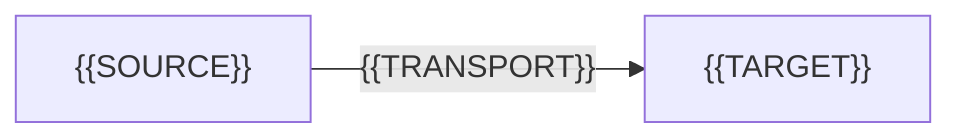

# {{FEATURE}} — design

> Fill every `{{PLACEHOLDER}}`. A section that does not apply stays in place and says why.
> Delete this note before circulating. This document records one decision; a second decision
> is a second document.

| Field | Value |
|---|---|
| Status | `draft` (then `review`, `accepted`, `rejected`, `withdrawn`) |
| Owner | {{NAME}} |
| Reviewers | {{NAMES_OR_TEAM}} |
| Created | {{YYYY-MM-DD}} |
| Supersedes | none |
| Related | {{RFC_ISSUE_OR_ADR_LINKS}} |

## Context

The system as it is today, in the reader's terms, and the constraint that makes this change
necessary. Include:

- the components involved and who owns each;
- the current limits — volume, latency, row counts, tenant counts — with measurement dates;
- the incident, deadline or forecast that makes this urgent.

{{CONTEXT_PARAGRAPHS}}

## Goals

Each goal is measurable and dated. A goal without a number is a wish, and a wish cannot be
reviewed.

| Goal | Current | Target | Measured by | By |
|---|---|---|---|---|
| {{GOAL}} | {{VALUE}} | {{VALUE}} | {{METHOD}} | {{DATE}} |

## Non-goals

What a reader might reasonably expect and will not get. Naming these prevents the review
from arguing about scope.

- {{NOT_THIS}} — {{WHY_IT_IS_OUTSIDE_THIS_DECISION}}

## Proposal

The design, one subsection per mechanism. The first paragraph of the section states the
whole proposal in five sentences; the subsections then defend it.

### {{MECHANISM_1}}

{{WHAT_IT_DOES}}, {{WHY_THIS_WAY}}, {{WHAT_IT_REPLACES}}.



### {{MECHANISM_2}}

{{WHAT_IT_DOES}}, {{WHY_THIS_WAY}}, {{WHAT_IT_REPLACES}}.

## Data model

Entities, keys, ownership and lifetime. Cardinality stated in words, not only in the
diagram.

| Entity | Owner | Key | Lifetime | Notes |
|---|---|---|---|---|
| {{ENTITY}} | {{SERVICE_OR_TEAM}} | {{KEY}} | {{RETAINED_UNTIL}} | {{...}} |

Retention and deletion: {{WHAT_IS_DELETED_WHEN_AND_BY_WHOM}}. Anything derived from personal
data states its deletion path here.

## API

Only the surface this design adds or changes. The full contract belongs in the API
specification.

| Method | Path or command | Purpose | Success | Errors |
|---|---|---|---|---|
| {{METHOD}} | `{{PATH}}` | {{PURPOSE}} | {{STATUS}} | {{CONDITIONS_AND_STATUSES}} |

Request and response shape for the primary operation:

```json
{{REAL_EXAMPLE_WITH_PLAUSIBLE_VALUES}}
```

## Failure modes

Every dependency is assumed to fail. Name what the reader will see, who is affected, and how
it is detected.

| Trigger | Symptom | Blast radius | Mitigation | Detection |
|---|---|---|---|---|
| {{DEPENDENCY_UNAVAILABLE}} | {{WHAT_USERS_SEE}} | {{WHO_IS_AFFECTED}} | {{RETRY_QUEUE_SHED_OR_FAIL_OPEN}} | {{ALERT_OR_METRIC}} |
| {{PARTIAL_WRITE}} | {{...}} | {{...}} | {{...}} | {{...}} |
| {{CAPACITY_EXCEEDED}} | {{...}} | {{...}} | {{...}} | {{...}} |

## Rollout

- **Stages:** {{STAGE_1}} → {{STAGE_2}}, with the gate between them stated as a metric and a
  threshold, not as "monitor closely".
- **Rollback unit:** {{WHAT_IS_REVERTED}}; **irreversible:**
  {{DATA_OR_STATE_THAT_CANNOT_BE_REVERTED}}.
- **Decision point:** {{WHO_DECIDES_TO_PROCEED_OR_HALT}}, at {{WHEN}}.
- **Feature flag or config:** {{NAME_AND_DEFAULT_OFF_OR_ON}}.

## Open questions

| Question | Owner | Decide by | Blocks |
|---|---|---|---|
| {{QUESTION}} | {{NAME}} | {{YYYY-MM-DD}} | {{NOTHING_OR_THE_SECTION}} |
