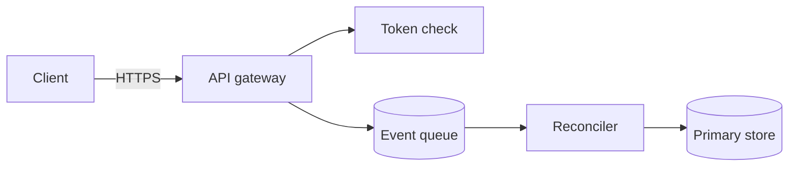
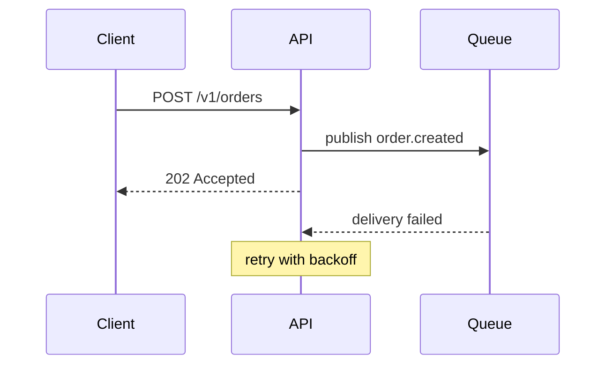
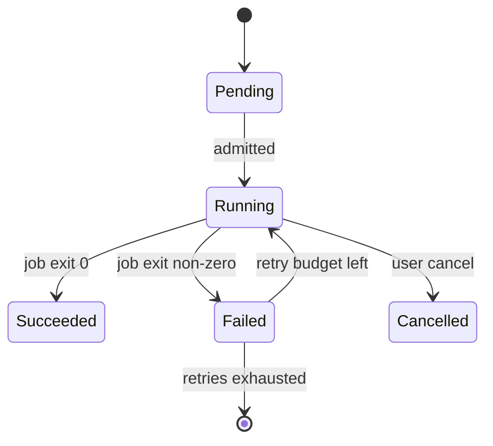
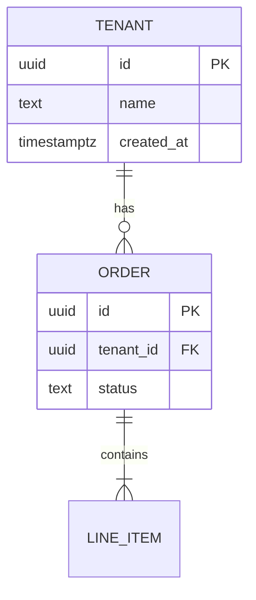

**Load this reference when:** deciding whether a diagram is worth drawing, writing Mermaid
for a design doc or RFC, or fixing a diagram that fails to render.

# Diagrams

A diagram replaces a paragraph only when the paragraph would force the reader to hold
several relations at once and re-read to check them. Every other use costs the reader a
scroll and the author a maintenance burden.

## When a diagram earns its place

| Draw it | Reason |
|---|---|
| Topology — three or more components with connections | Prose serialises a graph, so the reader rebuilds it in their head |
| A message sequence across two or more parties, with failures interleaved | Order and interleaving are what prose loses first |
| A state machine — three or more states with transitions | Reachability questions ("can it get back to `Running`?") need the graph |
| A schema — four or more tables with relations | Cardinality is easier to see than to read |

| Keep it prose or a table | Reason |
|---|---|
| Two components, one connection | "The gateway calls the API" is a sentence |
| A linear procedure | A numbered list is already a diagram of steps |
| Numbers per option, per period | A table, always — a chart of four values hides the values |
| Anything the reader will copy | A diagram cannot be copied; keep the payload in text |
| A decision tree with two branches | The branches are a sentence each |

The test before drawing: can one sentence, read once, give the reader the same conclusion?
If yes, write the sentence.

## The four types that survive rendering

Keep to these unless the target renderer is known to support more. Each example below is
valid Mermaid — the point of the reference is that the *shape* is stable, not that more
types are unsupported.

### flowchart — topology and flow



`LR` reads left to right and is the right default for a pipeline. Use `TD` for hierarchies.
Label edges with the verb or the transport — an unlabelled edge is a guess.

### sequenceDiagram — order across parties



`->>` solid request, `-->>` dashed response, `Note over` for reasoning prose. Declare
participants in the order the reader should meet them; Mermaid otherwise orders them by
first use, which is usually not the story order.

### stateDiagram-v2 — lifecycle



Include the terminal transitions. A state diagram whose states never reach `[*]` is telling
the reader that the lifecycle was not finished.

### erDiagram — schema and cardinality



Read the crow's foot right to left: `||--o{` is one tenant to zero-or-more orders. `||--|{`
is one-or-more. If you cannot say the relationship out loud in that direction, the
cardinality is wrong.

## Traps

| Trap | What breaks | What to write instead |
|---|---|---|
| Parentheses, slashes, colons in a flowchart label | The parser reads `(` as a shape, `:` as a classifier, `/[^…]/` as a bracket — the node fails or the label truncates | Quote every label that is not a bare word: `api["Rate limiter (per tenant)"]` |
| A colon inside sequence message text | The text after the first colon is the message; a second one reads as another separator in some renderers | `A->>B: POST v1 orders`, or `"status: 503"` in quotes |
| A semicolon anywhere in a label | Ends the statement; the rest of the line is lost | Remove it or use a dash |
| `#` in a label | Starts an entity code (`#quot;`, `#35;`) | Write the word, or use `&num;`-style escapes |
| A node id named `end` or another keyword | `end` closes a subgraph or a flowchart; the diagram fails with a parse error at an unrelated line | Prefix every id: `n_end`, `s_running`. Never use `graph`, `style`, `class`, `classDef`, `subgraph`, `click`, `default` as ids |
| `\n` for a line break | Rendered as the two characters | `<br/>` |
| A bare `"` inside a quoted label | Ends the label early | `&quot;` |
| Long labels | The diagram renders off the page; zooming does not restore readability | Break at 40–60 characters with `<br/>`; move detail into prose |
| `direction` inside a `subgraph` | Ignored when the parent flowchart already declares one | Set the direction once, on the flowchart |
| An erDiagram entity with spaces or dashes | Name parse failure | Uppercase identifier names only; put the human name in the relationship label |
| `%%` comments at the end of a statement line | Comment must occupy its own line | Put it on its own line |
| A node that nothing points to | Renders as an orphan the reader hunts for | Delete it, or connect it |
| A `{{PLACEHOLDER}}` left in a template's diagram | `{` opens a diamond node, so the parse fails on that token — a template that does not render cannot be checked | Quote the whole label: `source["{{SOURCE}}"]`, and quote edge labels too: `-->\|"{{TRANSPORT}}"\|` |

## Pre-flight checklist

- [ ] Every label containing `(`, `)`, `/`, `:`, `;`, `#` or a space is quoted.
- [ ] No id equals a Mermaid keyword; ids are prefixed and stable across edits.
- [ ] Line breaks are `<br/>`, not `\n`.
- [ ] One direction per flowchart, set at the top.
- [ ] Every node is reachable from the entry node; no orphan nodes.
- [ ] Every edge carries a verb or a transport when the reader could not infer it.
- [ ] State diagrams include terminal transitions; sequence diagrams declare their
  participants.
- [ ] The caption sentence states the conclusion the reader should draw — not "Architecture
  diagram".
- [ ] The diagram renders, and the rendered output was inspected.
- [ ] The same information exists in prose or a table if the reader must copy it.

## Rendering the check

Mermaid fails at render time, not at write time, and a static site that fails to parse a
diagram often shows nothing at all — sometimes not even an error. Render every new or edited
diagram and look at the output.

```console
npx -y @mermaid-js/mermaid-cli@11 -i docs/diagrams/flow.mmd -o /tmp/flow.svg
```

Pin the major version: syntax support changes between releases, and an unpinned `npx` turns a renderer release into a failure unrelated to the document.

The CLI exits non-zero on a parse error and prints the failing line, which is usually the
line above the real cause. Three follow-ups:

```console
test -s /tmp/flow.svg && echo rendered             # non-empty output
grep -o 'Rate limiter (per tenant)' /tmp/flow.svg  # the label survived
npx -y @mermaid-js/mermaid-cli@11 -i docs/diagrams/flow.mmd -o /tmp/flow.png -s 2
```

`-s` multiplies the pixels, which is the knob that makes a label legible. `-w` and `-H` set the
page viewport, not the file: the PNG is cropped to the diagram, so a 1400-wide request still
returns the diagram's own width in pixels. The size flag is not spelled `--size`, and an
unknown option fails the run before the diagram is parsed. Open the PNG at the width the
document will be read at: if the labels are not legible there, the diagram is too dense. The
CLI pulls a headless browser on first run, so it is a verification tool for the author's
machine by default. A repository whose docs build already renders diagrams runs this pinned
command in that job over every `.mmd`, not only the changed ones.

When a diagram lives in a fenced `mermaid` block inside a Markdown page, point the CLI at the
page — it renders every block and fails on the first broken one:

```console
npx -y @mermaid-js/mermaid-cli@11 -i docs/guide.md -o /tmp/guide.md -a /tmp/artefacts
```

The `-o` argument must end in `.md`, `.svg`, `.png` or `.pdf`, and the rendered charts land in
the `-a` directory as `guide-1.svg`, `guide-2.svg` and so on. A page of fences that nobody
renders is a page that breaks after the next dependency bump.

**What the SVG carries.** By default each label sits in a `<foreignObject>` — HTML inside an
SVG — so a consumer that does not render HTML (a PDF converter, a thumbnailer, a strict SVG
viewer) draws the shapes and no text. When the output leaves the browser, render the PNG or
PDF instead, since both go through Chromium. When the SVG itself must be portable, turn the
feature off in a config file, which emits `<text>` elements instead:

```json
{ "flowchart": { "htmlLabels": false }, "class": { "htmlLabels": false } }
```
