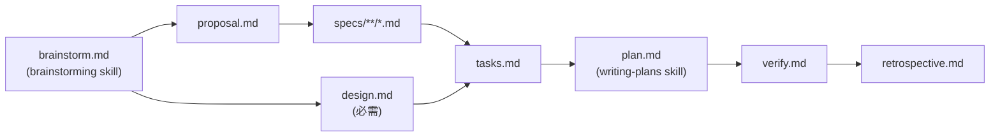

# superpowers-bridge Schema

把 OpenSpec 的规范驱动工作流(**做什么**)与 superpowers 的执行 skill(**怎么做**)
接成一条流水线,并补上一个 superpowers 原生没有的 `retrospective`(复盘)产物。

集成全部发生在提示层:不改 superpowers 源码,不改 OpenSpec CLI。
schema 版本:`version: 2`(dotfiles 用 git 历史记录版本,不再单独维护 VERSION 文件)。

**EN**

Connects OpenSpec's spec-driven workflow (**what to do**) with superpowers' execution
skills (**how to do it**) into a single pipeline, and adds a `retrospective` artifact
that superpowers does not provide natively. The whole integration happens at the
prompt layer: no changes to the superpowers source code, no changes to the OpenSpec
CLI. Schema version: `version: 2` (dotfiles tracks versions with git history and no
longer maintains a separate VERSION file).

---

## 1. 安装位置与生效范围 / Installation and scope

| 项 | 路径 |
|---|---|
| dotfiles 源码 | `home/dot_local/share/openspec/schemas/superpowers-bridge/` |
| 部署位置 | `~/.local/share/openspec/schemas/superpowers-bridge/` |
| schema 层 | OpenSpec **用户级** schema —— 所有项目通用,无需逐项目拷贝 |

`~/.local/share` 来自 `XDG_DATA_HOME=$HOME/.local/share`(dotfiles 的
`home/private_dot_system/env.sh.tmpl` 里设置)。OpenSpec 的用户级 schema 目录就是
`$XDG_DATA_HOME/openspec/schemas/<name>/`。

解析优先级:**project > user > package**。项目内若有同名目录
`openspec/schemas/superpowers-bridge/`,会覆盖这份用户级实现。

部署方式由 chezmoi 负责(纯静态文件,不需要安装后处理):

```bash
cd ~/.dotfiles && chezmoi apply
```

CLI 本体(`openspec` 命令)由 mise 纳管,见 dotfiles 的
`home/dot_config/mise/config.toml.tmpl` 里的 `npm:@fission-ai/openspec` 条目。

**EN**

| Item | Path |
|---|---|
| dotfiles source | `home/dot_local/share/openspec/schemas/superpowers-bridge/` |
| Deployment location | `~/.local/share/openspec/schemas/superpowers-bridge/` |
| Schema layer | OpenSpec **user-level** schema — shared by all projects, no per-project copy needed |

`~/.local/share` comes from `XDG_DATA_HOME=$HOME/.local/share` (set in dotfiles'
`home/private_dot_system/env.sh.tmpl`). OpenSpec's user-level schema directory is
exactly `$XDG_DATA_HOME/openspec/schemas/<name>/`.

Resolution priority: **project > user > package**. If a project contains a directory
of the same name, `openspec/schemas/superpowers-bridge/`, it overrides this
user-level implementation.

Deployment is handled by chezmoi — pure static files, no post-install processing
needed (`chezmoi apply`).

The CLI itself (the `openspec` command) is managed by mise; see the
`npm:@fission-ai/openspec` entry in dotfiles'
`home/dot_config/mise/config.toml.tmpl`.

---

## 2. artifact 流程 / Artifact flow



- `design` 是**必需产物**,承接 `brainstorm` 的重组职责:把 brainstorm 的原始捕获
  重组成背景 / 目标 / 决策 / 风险 / 迁移,并被 `tasks` 与 `plan` 引用。
- `apply` 阶段要求 `plan`(`requires: [plan]`),进度追踪文件是 `tasks.md`
  (`tracks: tasks.md`)。
- `verify` 与 `retrospective` 虽然在依赖图上挂在 `plan` 之后,实际产出时机在
  **apply 阶段之后**(详见 `schema.yaml` 里各自的时序说明与证据型 PRECHECK)。

产物与模板的对应关系(依赖边见上图):

| id | 生成物 | 模板 |
|---|---|---|
| `brainstorm` | `brainstorm.md` | `brainstorm.md` |
| `proposal` | `proposal.md` | `proposal.md` |
| `design` | `design.md` | `design.md` |
| `specs` | `specs/**/*.md` | `spec.md` |
| `tasks` | `tasks.md` | `tasks.md` |
| `plan` | `plan.md` | `plan.md` |
| `verify` | `verify.md` | `verify.md` |
| `retrospective` | `retrospective.md` | `retrospective.md` |

**EN**

- `design` is a **required artifact**. It takes over the restructuring duty of
  `brainstorm`: it restructures brainstorm's raw capture into background / goals /
  decisions / risks / migration, and it is referenced by `tasks` and `plan`.
- The `apply` phase requires `plan` (`requires: [plan]`); the progress tracking file
  is `tasks.md` (`tracks: tasks.md`).
- Although `verify` and `retrospective` hang after `plan` in the dependency graph,
  they are actually produced **after the apply phase** (see the timing notes and the
  evidence-based PRECHECK for each of them in `schema.yaml`).

The correspondence between artifacts and templates (see the diagram above for the
dependency edges):

| id | Artifact | Template |
|---|---|---|
| `brainstorm` | `brainstorm.md` | `brainstorm.md` |
| `proposal` | `proposal.md` | `proposal.md` |
| `design` | `design.md` | `design.md` |
| `specs` | `specs/**/*.md` | `spec.md` |
| `tasks` | `tasks.md` | `tasks.md` |
| `plan` | `plan.md` | `plan.md` |
| `verify` | `verify.md` | `verify.md` |
| `retrospective` | `retrospective.md` | `retrospective.md` |

---

## 3. 依赖 skill / Dependent skills

superpowers 系 skill 用**裸名**引用(不带 `superpowers:` 前缀),由 superpowers 插件
提供在 `~/.agents/skills/<name>/SKILL.md`。

| skill | 在哪一步用 | 缺失时的行为 |
|---|---|---|
| `brainstorming` | `brainstorm` 产物 | **立即报错中止**,不降级、不手写绕过 |
| `writing-plans` | `plan` 产物 | **立即报错中止**,不降级、不手写绕过 |
| `using-git-worktrees` | apply 第 1 步 | **立即报错中止**,不降级、不手写绕过 |
| `subagent-driven-development` | apply 第 2 步 | **立即报错中止**,不降级、不手写绕过 |
| `test-driven-development`(传递) | apply 第 2 步内被强制激活 | **立即报错中止** |
| `requesting-code-review`(传递) | apply 第 2 步内被强制激活 | **立即报错中止** |
| `finishing-a-development-branch` | apply 第 6 步 | **立即报错中止** |
| `openspec-verify-change` | apply 第 3 步 | **允许手动 fallback**:由执行者手工完成 verify 的 7 项检查并写入 `verify.md` |

`openspec-verify-change` 是唯一保留 fallback 的 skill —— 它是 OpenSpec 侧的验证
入口,不是 superpowers 的一部分。

**EN**

superpowers-family skills are referenced by **bare name** (without the `superpowers:`
prefix); the superpowers plugin provides them at
`~/.agents/skills/<name>/SKILL.md`.

| skill | Used at which step | Behavior when missing |
|---|---|---|
| `brainstorming` | `brainstorm` artifact | **hard abort**, no downgrade, no hand-written bypass |
| `writing-plans` | `plan` artifact | **hard abort**, no downgrade, no hand-written bypass |
| `using-git-worktrees` | step 1 of apply | **hard abort**, no downgrade, no hand-written bypass |
| `subagent-driven-development` | step 2 of apply | **hard abort**, no downgrade, no hand-written bypass |
| `test-driven-development` (transitive) | forcibly activated inside step 2 of apply | **hard abort** |
| `requesting-code-review` (transitive) | forcibly activated inside step 2 of apply | **hard abort** |
| `finishing-a-development-branch` | step 6 of apply | **hard abort** |
| `openspec-verify-change` | step 3 of apply | **manual fallback allowed**: the executor performs verify's 7 checks by hand and writes them into `verify.md` |

`openspec-verify-change` is the only skill that keeps a fallback — it is the
verification entry point on the OpenSpec side, not part of superpowers.

### 硬报错规则 / Hard abort rules

1. superpowers 系 skill 缺失 → 该步骤**立即停止**,列出缺失的 skill 名,并提示安装位置
   (`~/.agents/skills/<name>/SKILL.md`,或 superpowers 插件提供的同名 skill)。
2. **不允许**自行降级、不允许改用其他 skill、不允许手写产物绕过。
3. 平台不支持 subagent 时**不要**退到 `executing-plans` —— 按其 SKILL.md,它不会传递
   激活 TDD 与 code-review,会丢掉 superpowers 的核心价值。这类平台请改用内置
   `spec-driven` schema。

**EN**

1. A superpowers-family skill is missing → that step **stops immediately**, lists the
   missing skill names, and points at the installation location
   (`~/.agents/skills/<name>/SKILL.md`, or the same-named skill provided by the
   superpowers plugin).
2. Self-downgrading is **not allowed**, switching to another skill is **not allowed**,
   and hand-writing the artifact to bypass it is **not allowed**.
3. When the platform does not support subagents, do **not** fall back to
   `executing-plans` — per its SKILL.md it does not transitively activate TDD and
   code-review, which would drop the core value of superpowers. Use the built-in
   `spec-driven` schema on such platforms.

---

## 4. 机器可读标题(不可翻译) / Machine-readable headings (must not be translated)

中文化只发生在说明文案上。以下字面量被 OpenSpec 解析器按精确匹配读取,**必须保持英文**:

| 位置 | 必须保留的标题 |
|---|---|
| change(proposal) | `## Why`、`## What Changes` |
| 主 spec | `## Purpose`、`## Requirements` |
| delta spec | `## ADDED/MODIFIED/REMOVED/RENAMED Requirements`、`### Requirement:`、`#### Scenario:` |

标题一旦译成中文,`openspec validate` 会直接报
`Change must have a Why section` / `Spec must have a Purpose section`。

**EN**

Localization only happens in the explanatory prose. The literals below are read by
the OpenSpec parser through exact matching and **must stay in English**:

| Location | Headings that must be preserved |
|---|---|
| change (proposal) | `## Why`, `## What Changes` |
| Main spec | `## Purpose`, `## Requirements` |
| delta spec | `## ADDED/MODIFIED/REMOVED/RENAMED Requirements`, `### Requirement:`, `#### Scenario:` |

If a heading is translated into Chinese, `openspec validate` fails immediately with
`Change must have a Why section` / `Spec must have a Purpose section`.

---

## 5. 兼容性 / Compatibility

| 项 | 版本 |
|---|---|
| OpenSpec CLI | **1.15.0**(mise 纳管:`npm:@fission-ai/openspec` = "latest",本机实测通过) |
| schema version | `2` |

- 1.3.x 与 1.15.x 都实测通过。1.15.x 起 `openspec status --json` 有两处变化:
  同级 artifact 排序从字母序改为**声明顺序**,且每个 artifact 多了 `requires` 字段
  (`missingDeps` 位置后移)。这只影响 JSON 形状,不影响 `requires` 语义与流程正确性。
- CLI 由 mise 纳管,跟着 `mise upgrade` 走。**升级后必须重跑** §6 的命令,
  确认结构校验与端到端流程仍然通过。
- superpowers 系 skill 由插件提供,不纳入 dotfiles 管理。一台没装插件的新机器上,
  schema 会在对应步骤按设计立即报错中止 —— 这是预期行为。

**EN**

| Item | Version |
|---|---|
| OpenSpec CLI | **1.15.0** (managed by mise: `npm:@fission-ai/openspec` = "latest", verified on this machine) |
| schema version | `2` |

- Both 1.3.x and 1.15.x have been verified in practice. Since 1.15.x,
  `openspec status --json` has two changes: sibling artifacts are sorted by
  **declaration order** instead of alphabetical order, and every artifact gains a
  `requires` field (the `missingDeps` position moves later). This only affects the
  JSON shape, not the semantics of `requires` and not the correctness of the flow.
- The CLI is managed by mise and follows `mise upgrade`. After an upgrade you
  **must re-run** the commands in §6 to confirm that structural validation and the
  end-to-end flow still pass.
- The superpowers-family skills are provided by the plugin and are not managed by
  dotfiles. On a new machine without the plugin installed, the schema hard-aborts
  by design at the corresponding step — this is the expected behavior.

---

## 6. 验收命令 / Verification commands

以下命令在**任意目录**执行(带 schema 名时 OpenSpec 会跨 project / user / package 三层解析;
不带名字时只校验 project 层,不足以验证用户级安装):

```bash
# 1. 部署落点
ls -R ~/.local/share/openspec/schemas/superpowers-bridge

# 2. schema 结构校验 → 期望 "✓ Schema 'superpowers-bridge' is valid"
cd /tmp && openspec schema validate superpowers-bridge

# 3. 用户层生效 → 期望列出 superpowers-bridge (user override)
cd /tmp && openspec schemas
cd /tmp && openspec schema which superpowers-bridge

# 4. 模板解析 → 期望 8 个 artifact 的 path 都指向用户级 templates/
cd /tmp && openspec templates --schema superpowers-bridge --json

# 5. 端到端 change 流程
mkdir -p /tmp/bridge-acceptance && cd /tmp/bridge-acceptance && openspec init --tools none
openspec new change zh-cn-acceptance --schema superpowers-bridge
openspec status --change zh-cn-acceptance --schema superpowers-bridge --json
openspec instructions brainstorm --change zh-cn-acceptance --schema superpowers-bridge --json
```

改完 schema 或升级 CLI 后,把 1-5 逐条重跑一遍。接入侧(项目里只写 `config.yaml`)的步骤见 §7。

**EN**

Run the commands above in **any directory** (with a schema name, OpenSpec
resolves across the project / user / package layers; without a name it only
validates the project layer, which is not enough to verify a user-level
installation):

After changing the schema or upgrading the CLI, re-run items 1-5 one by one. The
adoption-side steps (only a `config.yaml` in the project) are described in §7.

---

## 7. 新项目接入 / Adopting in a new project

接入步骤见 dotfiles 的 `docs/OPENSPEC-BRIDGE.md`:每个项目只写一个 `openspec/config.yaml`
(`schema: superpowers-bridge`),**不跑 `openspec init`**,项目内不生成 `.agents/skills/`,
也不拷贝 schema —— schema 是用户级安装
(`~/.local/share/openspec/schemas/superpowers-bridge/`),openspec 与 superpowers 的 skill
全部由用户级 `~/.agents/skills/` 提供,所有项目共用。

从本 schema 的角度,接入方只需保证三件事:

- `openspec/config.yaml` 里有 `schema: superpowers-bridge`(或每次 `--schema` 传参);
- §3 列出的 superpowers 系 skill 可见 —— 缺失即按设计中止,不降级;
- 需要 agent 路由规则时,把 `adopters/AGENTS.md.fragment.md` 整段追加到项目根 `AGENTS.md`。

既有 change 不迁移:`.openspec.yaml` 里固化的 `schema:` 优先于 `config.yaml`。

**EN**

The adoption steps are described in dotfiles' `docs/OPENSPEC-BRIDGE.md`: every
project writes only one `openspec/config.yaml` (`schema: superpowers-bridge`),
does **not** run `openspec init`, generates no `.agents/skills/` inside the
project, and does not copy the schema — the schema is installed at the user level
(`~/.local/share/openspec/schemas/superpowers-bridge/`), and all openspec and
superpowers skills are provided by the user-level `~/.agents/skills/`, shared by
every project.

From this schema's point of view, the adopter only has to guarantee three things:

- `openspec/config.yaml` contains `schema: superpowers-bridge` (or passes `--schema`
  on every invocation);
- the superpowers-family skills listed in §3 are visible — a missing skill means
  abort by design, no downgrade;
- when agent routing rules are needed, append the whole
  `adopters/AGENTS.md.fragment.md` to the project root `AGENTS.md`.

Existing changes are not migrated: the `schema:` pinned in `.openspec.yaml` takes
precedence over `config.yaml`.

### `openspec-verify-change` 的降级 / `openspec-verify-change` downgrade

全局 `profile: core` 只装 propose / explore / apply / update / sync / archive,不含
`openspec-verify-change`。这是**唯一**允许降级的 skill:`verify` 阶段改为按 schema 的
7 项手工检查执行并写入 `verify.md`。

**EN**

The global `profile: core` installs only propose / explore / apply / update / sync /
archive, and does not include `openspec-verify-change`. This is the **only** skill
allowed to downgrade: the `verify` phase instead runs the schema's 7 manual checks
and writes the result into `verify.md`.

### 路由片段 / Routing fragment

`adopters/AGENTS.md.fragment.md` 是路由片段的唯一来源:整段追加到项目根 `AGENTS.md`。
片段内容是:

- 本项目走 `superpowers-bridge` schema(用户级安装,无需项目内拷贝);
- 8 个产物与依赖 skill 清单;
- 「skill 缺失立即停止并告知用户,不得降级」的判读规则;
- 什么情况下直接开 PR、不必开 change —— 流程仪式要与风险成比例;
- 叙述式 brainstorming 升级成 change 的 5 条门槛与前门反模式。

**EN**

`adopters/AGENTS.md.fragment.md` is the single source of the routing fragment:
append the whole thing to the project root `AGENTS.md`. The fragment contains:

- This project uses the `superpowers-bridge` schema (user-level install, no
  in-project copy);
- the list of 8 artifacts and the dependent skills;
- the interpretation rule "if a skill is missing, stop immediately and tell the
  user; do not downgrade";
- when to open a PR directly instead of opening a change — process ceremony must be
  proportional to the risk;
- the 5 thresholds and the front-door anti-patterns for escalating a narrative
  brainstorming into a change.
